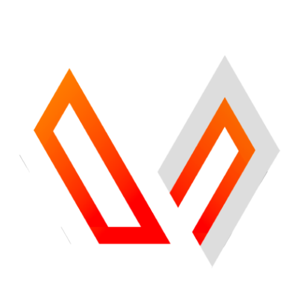

<p align="center">
  
</p>

<div align="center">

  [](https://discord.gg/nW73CdBYkg)
  [](https://vanguardproject.ru/)
  [](https://store.steampowered.com/app/1255460/Space_Station_14/)
  [](https://spacestation14.com/about/download/)
  [](https://github.com/VG-SpaceStation14/VanGuardSS14)

</div>

---

## 🚀 О проекте

**VanGuard** — русскоязычный сервер и форк [space-syndicate/space-station-14](https://github.com/space-syndicate/space-station-14), который основан на [space-wizards/space-station-14](https://github.com/space-wizards/space-station-14). Игра работает на движке [Robust Toolbox](https://github.com/space-wizards/RobustToolbox).

Space Station 14 — ролевая игра, вдохновлённая Space Station 13. Проект поддерживает перевод, регулярно получает изменения из апстрима и содержит собственные доработки. Описание механик находится на [вики](https://vanguardproject.ru/).

## 🛠 Сборка

**Требования:** [.NET SDK 10.0+](https://dotnet.microsoft.com/download/dotnet/10.0) и [Python 3](https://www.python.org/downloads/).

1. Склонируйте репозиторий:
```shell
git clone https://github.com/VG-SpaceStation14/VanGuardSS14.git
cd VanGuardSS14
```
2. Запустите `RUN_THIS.py`. Скрипт инициализирует подмодули (включая Robust Toolbox) и подготавливает репозиторий к сборке:
```shell
python RUN_THIS.py
```
3. Соберите проект:
```shell
dotnet build
```
4. Запуск для локальной проверки:
```shell
dotnet run --project Content.Server
dotnet run --project Content.Client
```

[Подробная инструкция по сборке и запуску сервера](https://docs.spacestation14.com/en/general-development/setup/server-hosting-tutorial.html)

## 🤝 Контрибьют

Заходите в [Discord](https://discord.gg/nW73CdBYkg), если хотите помочь. Список задач находится в [issues](https://github.com/VG-SpaceStation14/VanGuardSS14/issues), взять можно любую.

Изменения и пулл-реквесты должны соответствовать [стандартным правилам SS14](https://docs.spacestation14.com/en/general-development/codebase-info/pull-request-guidelines.html).

**Использование ИИ.** Нейросети разрешено использовать как инструмент для написания кода. Автор пулл-реквеста полностью отвечает за результат: код должен проходить тесты и не нарушать лицензионную совместимость проекта (MIT). Автоматические проверки не заменяют самостоятельную проверку. В остальном действуют стандартные правила SS14.

## ⚖️ Лицензия

**Код — MIT.**
Исходный код в этом репозитории распространяется под лицензией [MIT](https://github.com/VG-SpaceStation14/VanGuardSS14/blob/master/LICENSE.TXT).

**Унаследованный код.**
Апстрим space-syndicate/space-station-14 распространяется под MIT, согласно его README и файлу лицензии. Унаследованный код сохраняет исходные уведомления об авторских правах. Каталог `Corvax/` относится к коду и ассетам апстрима и лицензируется так, как указано в апстриме.

**Ассеты — CC-BY-SA 3.0.**
Большинство ресурсов (спрайты, звуки) лицензированы по [CC-BY-SA 3.0](https://creativecommons.org/licenses/by-sa/3.0/), если не указано иное. Лицензия и авторство каждого ресурса указаны в его метаданных (`meta.json` или `attributions.yml`). [Пример](https://github.com/VG-SpaceStation14/VanGuardSS14/blob/master/Resources/Textures/Objects/Tools/crowbar.rsi/meta.json).

**Ассеты с некоммерческими лицензиями.**
Часть ассетов лицензирована по [CC-BY-NC-SA 3.0](https://creativecommons.org/licenses/by-nc-sa/3.0/) или аналогичным некоммерческим лицензиям. Для коммерческого использования проекта их необходимо удалить. Найти их можно так:
```shell
grep -rlE '(license": *"|license: *")CC-BY-NC' Resources/
```

---
*VanGuard — форк space-syndicate/space-station-14, который базируется на space-wizards/space-station-14. Благодарим сообщества обоих проектов.*
